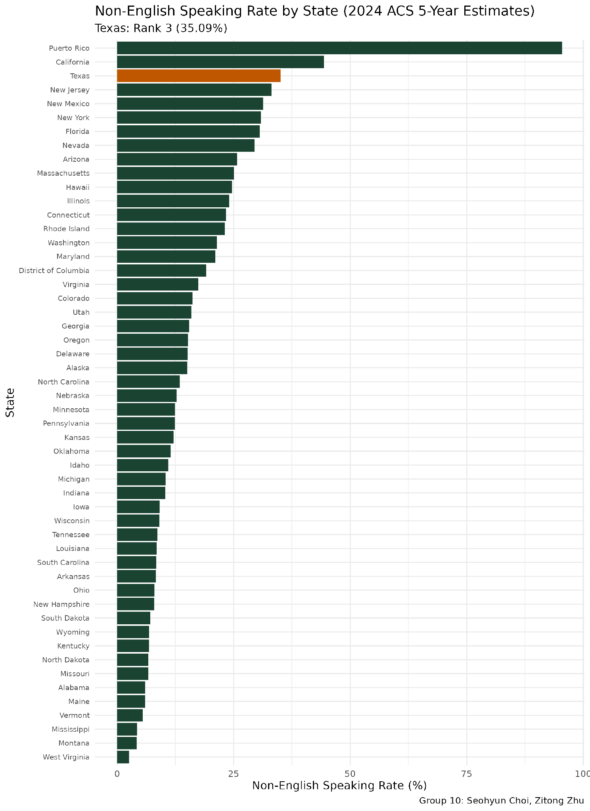
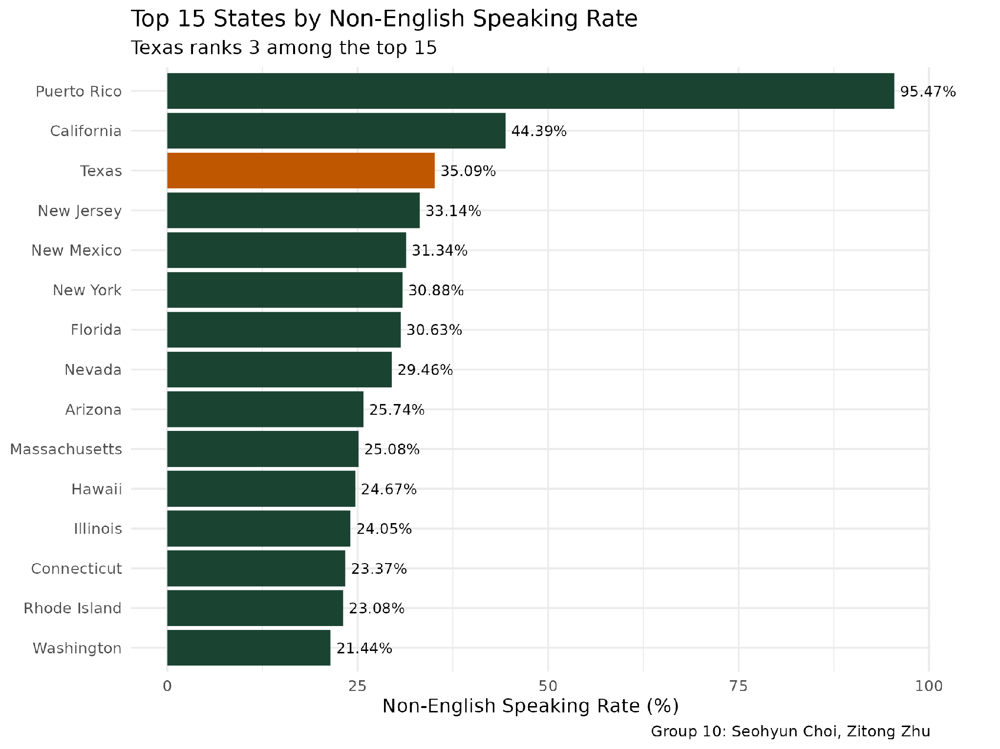
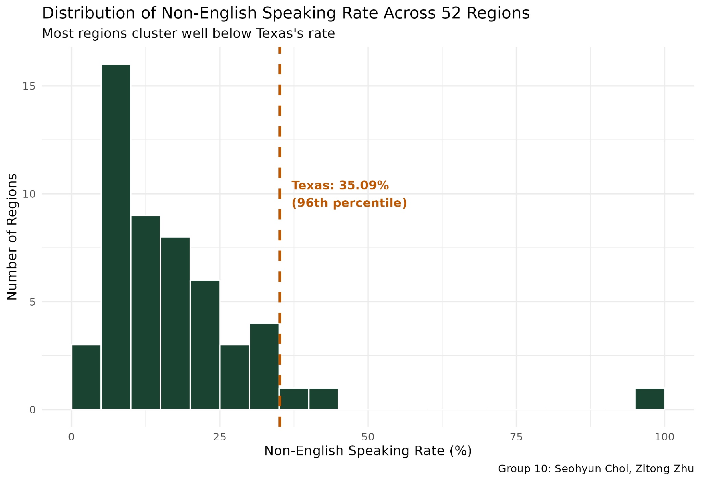
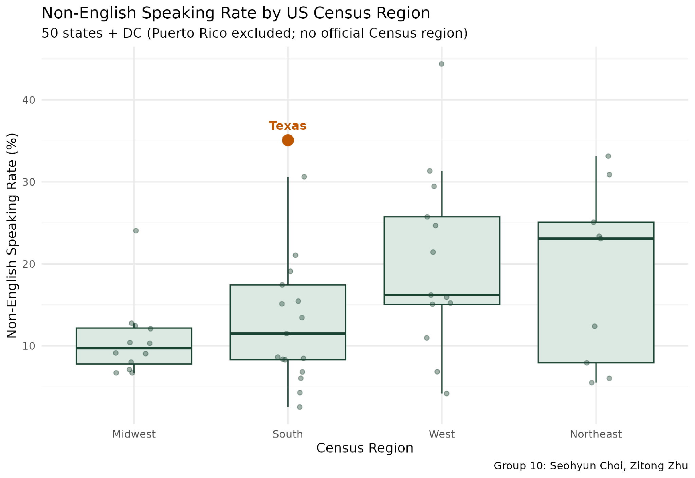
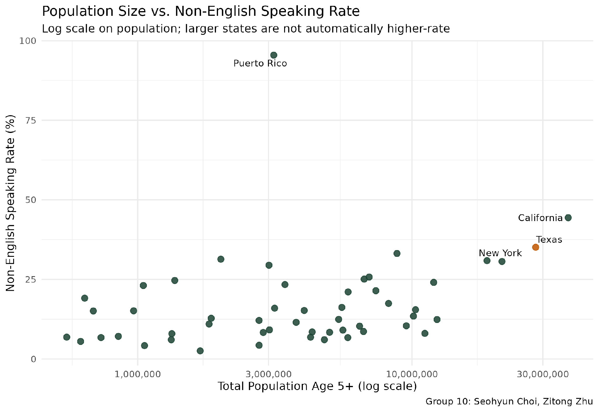

# Non-English Speaking Rate by State: Where Does Texas Rank?

**텍사스는 집에서 영어 외 언어를 쓰는 인구 비율이 미국 52개 지역 중 몇 위일까?** 
US Census 공개 데이터(2024 ACS 5-Year, Table B16001)를 R로 정제·분석·시각화한 UT Austin 데이터 분석 수업 텀 프로젝트입니다. 결과는 3위(35.09%)입니다.

Term project for the Data Analytics (Big Data & Data Mining) course, UT Austin Summer 2026 — Group 10: Seohyun Choi, Zitong Zhu.

## Research question

Among 52 regions (50 states + DC + Puerto Rico), what is Texas's rank in the share of the population (age 5+) that speaks a language other than English at home?

## Data

- US Census Bureau, **Table B16001** — *Language Spoken at Home by Ability to Speak English for the Population 5 Years and Over*, 2024 American Community Survey (ACS) 5-Year Estimates (data.census.gov).
- Raw file: 128 rows × 105 columns (1 label column + 52 regions × Estimate and Margin of Error).
- Working dataset after cleaning: 52 rows × 5 columns (`state`, `total`, `english_only`, `non_english`, `pct_non_english`).

## Method

1. **Load and clean** — strip the CSV's byte-order mark, remove the non-breaking-space indentation that encodes the Census row hierarchy (regex), keep only the `Total:` and `Speak only English` rows, drop all Margin of Error columns.
2. **Reshape** — `pivot_longer()` then `pivot_wider()` to one row per region.
3. **Derive** — `non_english = total − english_only`, `pct_non_english = non_english / total × 100`.
4. **Rank** all 52 regions with `dplyr::arrange()` and locate Texas.
5. **Describe** — mean, median, SD, min, max, Texas's percentile.
6. **Visualize** with `ggplot2` (Texas highlighted in every chart).
7. **Applied improvement** — one-sample t-test comparing the other 51 regions with Texas's rate.

## Results

Texas ranks **#3 of 52** with **35.09%** (9,913,837 of 28,253,216 people age 5+), behind only Puerto Rico and California.

| Rank | Region | Non-English rate |
|---|---|---|
| 1 | Puerto Rico | 95.47% |
| 2 | California | 44.39% |
| 3 | **Texas** | **35.09%** |
| 4 | New Jersey | 33.14% |
| 5 | New Mexico | 31.34% |
| 6 | New York | 30.88% |
| 7 | Florida | 30.63% |

| Statistic (52 regions) | Value |
|---|---|
| Mean | 17.0% |
| Median | 12.6% |
| Standard deviation | 14.6 |
| Min | 2.54% (West Virginia) |
| Max | 95.47% (Puerto Rico) |
| Texas percentile | 96.2 |

Texas's rate is about twice the 52-region mean and nearly three times the median. A one-sided one-sample t-test (other 51 regions vs. 35.09%) gives mean = 16.68%, t = −9.057, df = 50, p = 2.02 × 10⁻¹².

### Figures

| | |
|---|---|
|  |  |
|  |  |
|  | |

Population size alone does not explain the ranking (Figure 5), and Texas is an outlier even within the Census South region (Figure 4).

## Repository structure

```
data/      language_by_state.csv        raw Census export (Table B16001)
scripts/   group10_analysis_final.R     full pipeline: clean → reshape → rank → stats → charts → t-test
output/    fig1 … fig5 (.png)           charts (taken from the report; re-running the script regenerates them)
report/    Group10_TermProject_Report.pdf
```

## How to run

```r
# R packages
install.packages(c("dplyr", "tidyr", "ggplot2", "ggrepel", "scales"))
```

Run from the repository root so the relative paths (`./data`, `./output`) resolve:

```bash
Rscript scripts/group10_analysis_final.R
```

## Limitations and possible extensions

- The 52 regions are the entire population of interest, so the t-test is an illustrative check on the ranking rather than a full inferential argument.
- Margin of Error columns were dropped; adding them would allow confidence intervals and a test of whether Texas's rank differs from close neighbors (New Jersey, New Mexico).
- Break "non-English" down by language (Spanish, Vietnamese, Chinese, …) to see which languages drive Texas's rank.
- Pull the table via `tidycensus` / the Census API instead of a manual CSV export so the pipeline is reusable for other ACS tables and years.
- Add a choropleth map (`sf` / `usmap`).

## Source

U.S. Census Bureau. (2024). *Table B16001: Language Spoken at Home by Ability to Speak English for the Population 5 Years and Over.* 2024 American Community Survey 5-Year Estimates. data.census.gov.
